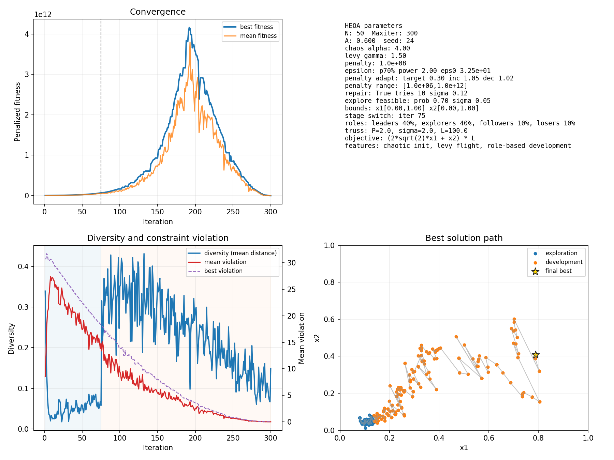
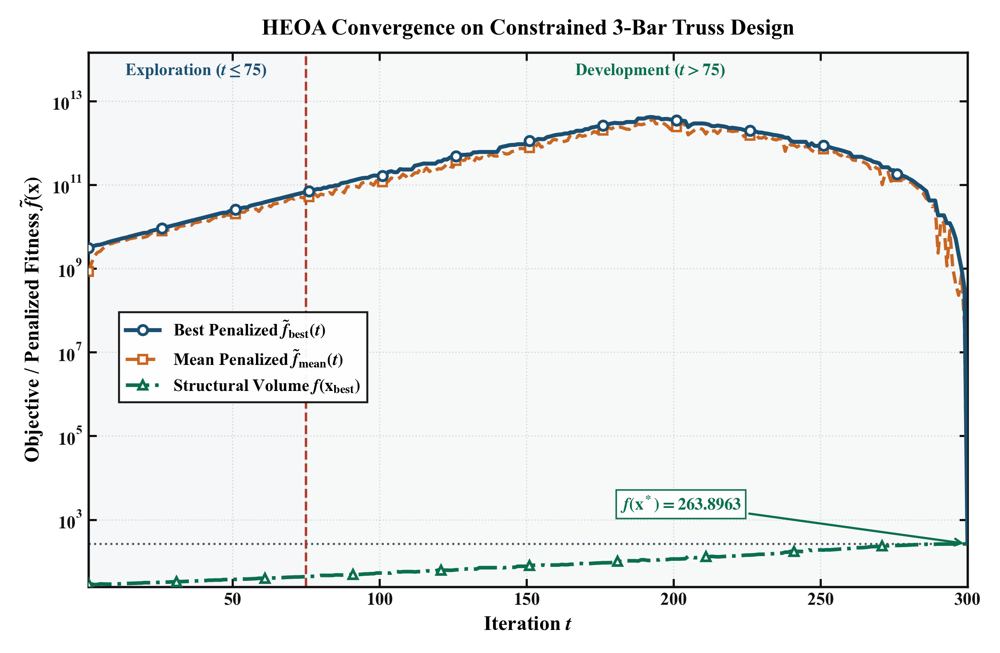
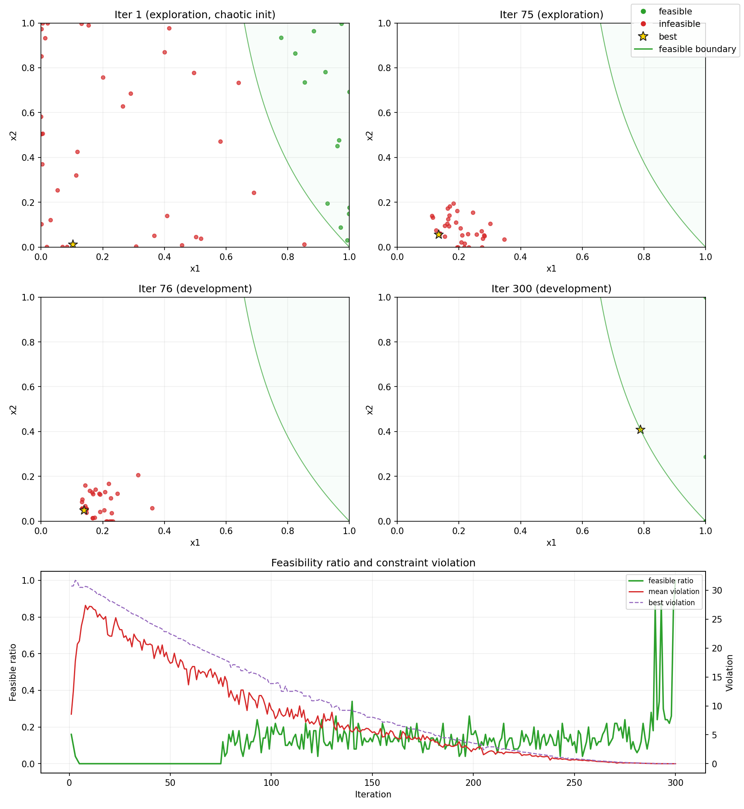
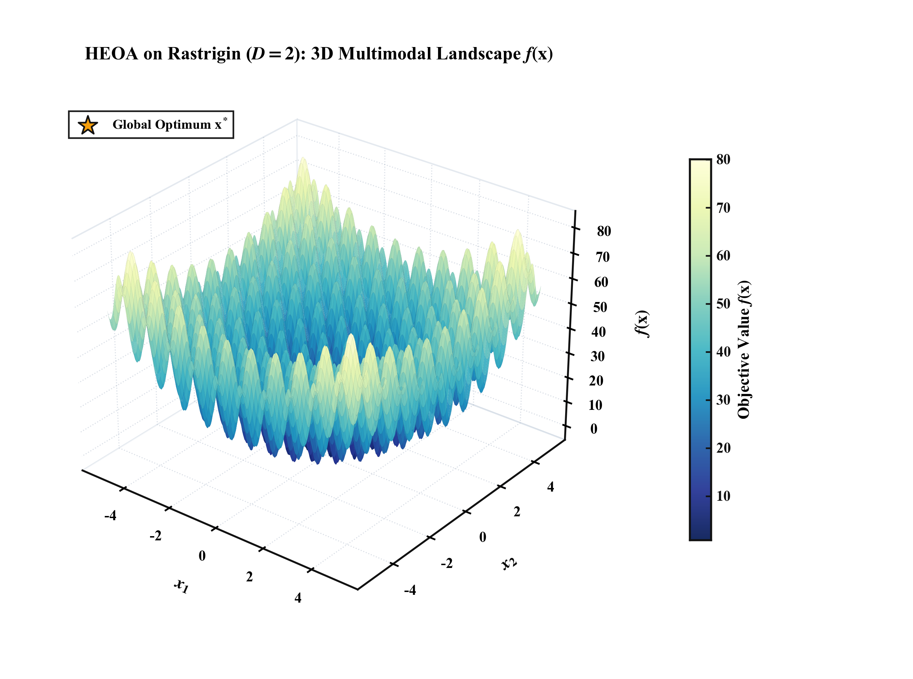
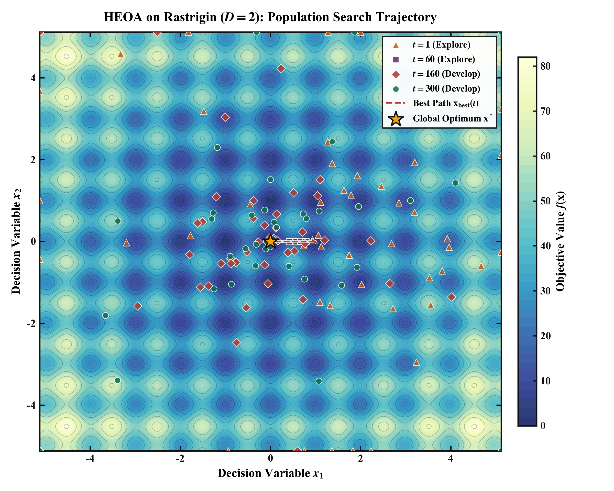
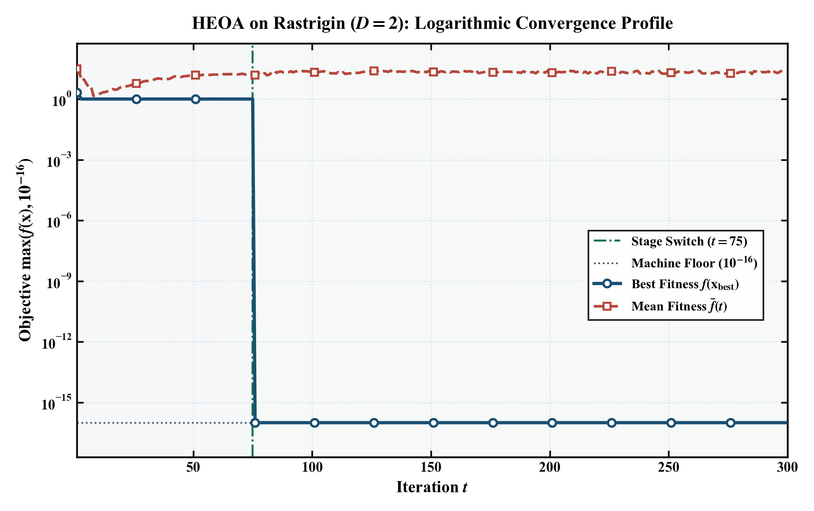
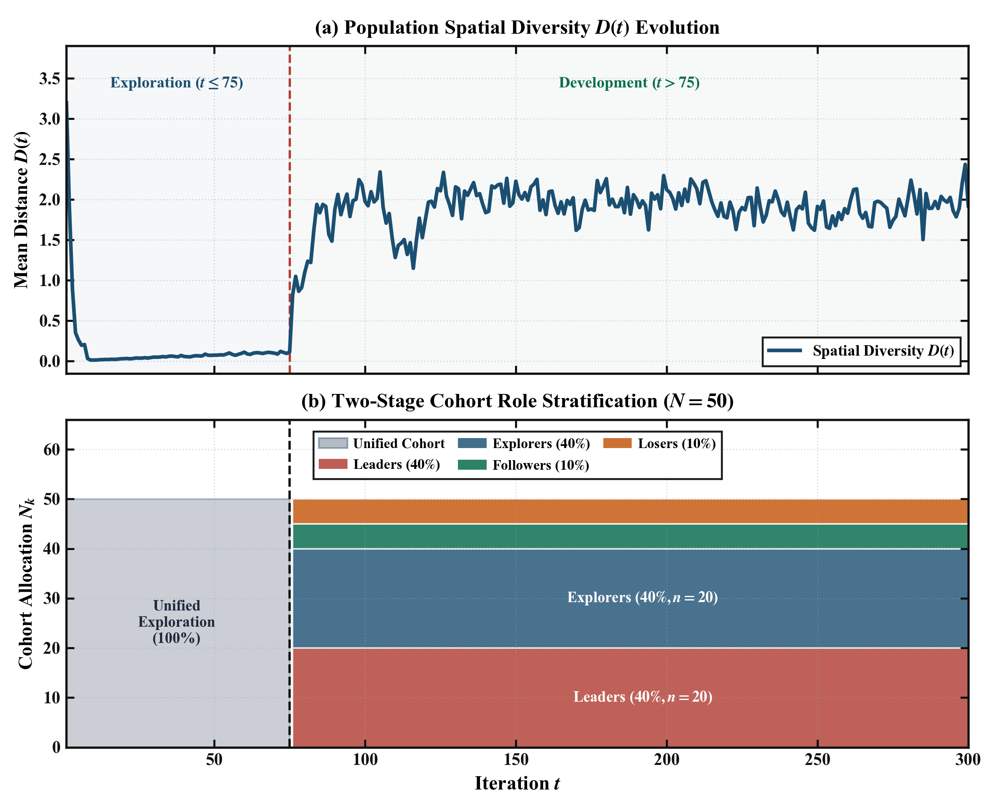

# HEOA: Human Evolutionary Optimization Algorithm Reproducibility & Constrained Engineering Design

> **Paper Reading, Mathematical Verification & Enhanced Constrained Optimization Reproduction**  
> Based on Lian et al. (2024), *"Human Evolutionary Optimization Algorithm"*, *Expert Systems with Applications*, 241, 122638.

---

## 1. Overview · 项目简介

本仓库对 **人类进化优化算法（Human Evolutionary Optimization Algorithm, HEOA）** 进行了完整的数学公式梳理、无约束基准函数可视化复现，以及面向 **三杆桁架工程约束优化问题（3-Bar Truss Design Problem）** 的约束处理机制（Constraint Handling Techniques, CHT）增强实验。

针对原论文在强非线性不等式约束边界附近易出现不可行解振荡的问题，本项目在标准 HEOA 的 **探索阶段（Exploration）** 与 **发展阶段（Development）** 基础上，引入了 **Deb 可行性优先准则**、**动态 $\epsilon$-约束松弛调度**、**自适应罚函数缩放** 以及 **可行域方向修复算子（Candidate Repair）**，在 30 次独立随机实验中实现了 **100% 严格可行率（30/30 Feasible）** 与稳定的高精度收敛。

---

## 2. Algorithm Formulation · 核心数学机制

HEOA 将全局寻优划分为初始化与两大进化阶段：

### 2.1 混沌映射初始化（Logistic Chaos Mapping, Eqs. 1–2）
采用 Logistic 混沌序列提升初始种群在搜索空间 $[lb, ub]^D$ 内的遍历性与均匀度（$\alpha = 4.0$）：

$$
z_{i}^{(k+1)} = \alpha \, z_{i}^{(k)} \left(1 - z_{i}^{(k)}\right), \qquad X_i^0 = lb + (ub - lb) \odot z_i
$$

### 2.2 人类探索阶段（Human Exploration Stage, $t \le \lfloor \text{Maxiter}/4 \rfloor$, Eqs. 3–7）
前 $1/4$ 迭代通过 **Mantegna Lévy 飞行**、**自适应反馈系数 $\beta$** 与 **空间跳跃策略（Jumping Strategy）** 跳出局部极值：

$$
X_i^{t+1} = \beta \left(1 - \frac{t}{\text{Maxiter}}\right) (X_i^t - X_{\text{best}}) \odot \text{Lévy}(\gamma) + X_{\text{best}}\left(1 - \frac{t}{\text{Maxiter}}\right) + (X_{\text{mean}}^t - X_{\text{best}}) \cdot f_{\text{jump}}
$$

### 2.3 人类发展阶段（Human Development Stage, $t > \lfloor \text{Maxiter}/4 \rfloor$, Eqs. 8–12）
后 $3/4$ 迭代按适应度排序将种群划分为四类协同演化角色：
- **Leaders（前 40%，Eq. 8）**：结合余弦衰减知识系数 $\omega = 0.2\cos\left(\frac{\pi}{2}(1 - \frac{t}{\text{Maxiter}})\right)$ 进行局部精细开发与高斯扰动探索；
- **Explorers（40%–80%，Eq. 10）**：依托最差个体参考距离指数项 $\exp\left(\frac{X_{\text{worst}}^2 - X_i^2}{\text{rank}^2}\right)$ 维持中层种群多样性；
- **Followers（80%–90%，Eq. 11）**：向当前全局最优解 $X_{\text{best}}$ 定向跟随收敛；
- **Losers（最后 10%，Eq. 12）**：围绕 $X_{\text{best}}$ 执行对称高斯重构以淘汰劣质解。

---

## 3. Constrained Engineering Optimization · 三杆桁架约束优化（Eq. 13）

### 3.1 数学模型
最小化三杆桁架结构体积 $f(x)$，设计变量为杆件截面积 $x = [x_1, x_2]^\top \in [0, 1]^2$：

$$
\min_{x \in [0,1]^2} f(x) = \left(2\sqrt{2}\,x_1 + x_2\right) \cdot l
$$

受限于 3 条应力不等式约束（$l = 100,\; P = 2,\; \sigma = 2$）：

$$
\begin{aligned}
g_1(x) &= \frac{\sqrt{2}\,x_1 + x_2}{\sqrt{2}\,x_1^2 + 2x_1 x_2} P - \sigma \le 0 \\
g_2(x) &= \frac{x_2}{\sqrt{2}\,x_1^2 + 2x_1 x_2} P - \sigma \le 0 \\
g_3(x) &= \frac{1}{\sqrt{2}\,x_2 + x_1} P - \sigma \le 0
\end{aligned}
$$

### 3.2 约束处理增强机制（Constraint Handling Techniques）
在 [`heoa_repro/heoa_truss_repro.py`](heoa_repro/heoa_truss_repro.py) 中实现了四重约束保障机制：
1. **Deb 可行性优先排序（`rank_population` / `is_better`）**：可行解始终优于不可行解；同为可行解时比较原始目标 $f(x)$，同为不可行解时比较约束违背度 $\nu(x) = \sum_{j=1}^3 \max(0, g_j(x))$。
2. **动态 $\epsilon$-约束松弛调度（`epsilon_schedule`）**：以初始种群违背度分位数 $\epsilon_0$ 为起点，按幂律 $\epsilon(t) = \epsilon_0 (1 - t/\text{Maxiter})^p$ 平滑收缩至 $0$，帮助早期种群穿越狭窄可行域边界。
3. **自适应罚系数调节（`update_penalty`）**：监控每代可行解比例，动态缩放罚系数 $\lambda_t \in [10^6, 10^{12}]$。
4. **越界与不可行候选修复算子（`repair_candidate` & `sample_feasible`）**：对超出 $\epsilon(t)$ 的候选解执行朝向 $X_{\text{best}}$ 的凸组合内插搜索与可行池局部采样。

### 3.3 统计结果（30 Independent Runs, $N=50, \text{Maxiter}=300$）

| 指标 (Metric) | 数值 (Value) | 说明 |
| :--- | :--- | :--- |
| **Best Objective $f(x^*)$** | **`263.896314`** | 紧贴理论主动约束边界 $g_1(x^*) = -3.42 \times 10^{-6} \le 0$ |
| **Optimal Design $x^*$** | **`[0.788516, 0.408704]`** | $g(x^*) = [-3.42\times 10^{-6},\; -1.4636,\; -0.5364]$ |
| **Mean $\pm$ Std** | **`264.833634 ± 0.814305`** | 30 次独立随机种子实验均值与标准差 |
| **Median / Worst** | `264.564444` / `267.600563` | 中位数与最差运行结果 |
| **Feasibility Rate** | **`100.0% (30 / 30)`** | 全部独立运行均收敛至严格可行域内 |

#### 三杆桁架综合分析视图


| 收敛与阶段切换曲线 | 约束违背度与可行率演化 |
| :---: | :---: |
|  |  |

---

## 4. Unconstrained Benchmark Visualization · 基准函数寻优可视化

[`heoa_repro/heoa_visual.py`](heoa_repro/heoa_visual.py) 提供了标准多峰/单峰基准函数（`rastrigin`, `ackley`, `griewank`, `rosenbrock`, `sphere`）的 3D 曲面、等高线种群轨迹、收敛曲线及四类角色多样性演化分析。以 2D Rastrigin 函数为例（收敛至全局最优 $f(x^*) = 0.0$）：

| 目标函数 3D 曲面 | 种群搜索轨迹与角色收敛 |
| :---: | :---: |
|  |  |
| **适应度对数收敛曲线** | **种群多样性与四类角色演化** |
|  |  |

---

## 5. Quick Start · 快速复现

### 环境依赖
```bash
python -m pip install -r requirements.txt
```

### 1) 复现三杆桁架约束优化（生成 30 次统计 JSON/CSV 与分析图）
```bash
python heoa_repro/heoa_truss_repro.py
```
运行后将更新：
- 统计数据：[`heoa_repro/heoa_truss_results.json`](heoa_repro/heoa_truss_results.json)、[`heoa_repro/heoa_truss_results.csv`](heoa_repro/heoa_truss_results.csv)
- 可视化图表：`heoa_repro/heoa_truss_*.png`

### 2) 运行基准测试函数可视化
```bash
python heoa_repro/heoa_visual.py --func rastrigin --dim 2 --n_pop 50 --max_iter 300 --seed 0 --out heoa_outputs_fixed
```

---

## 6. Repository Structure · 目录结构

```text
HEOA/
├── heoa_repro/
│   ├── heoa_truss_repro.py          # 三杆桁架约束优化主程序（含增强 CHT 与可视化）
│   ├── heoa_visual.py               # 经典无约束基准函数复现与轨迹可视化脚本
│   ├── heoa_truss_results.json      # 30 次独立实验完整统计记录
│   ├── heoa_truss_results.csv       # 30 次独立实验表格汇总
│   └── heoa_truss_*.png             # 三杆桁架收敛、可行域边界与种群演化图
├── heoa_outputs_fixed/              # Rastrigin 基准函数 3D 曲面、轨迹与多样性演化图
├── requirements.txt                 # Python 依赖声明 (NumPy, Matplotlib)
├── LICENSE                          # MIT 开源许可
└── README.md                        # 项目文档
```

---

## 7. Reference · 参考文献

- Lian, J., Hui, G., Ma, L., Zhu, T., Wu, X., Heidari, A. A., Chen, Y., & Chen, H. (2024). Human evolutionary optimization algorithm. *Expert Systems with Applications*, 241, 122638. https://doi.org/10.1016/j.eswa.2023.122638
